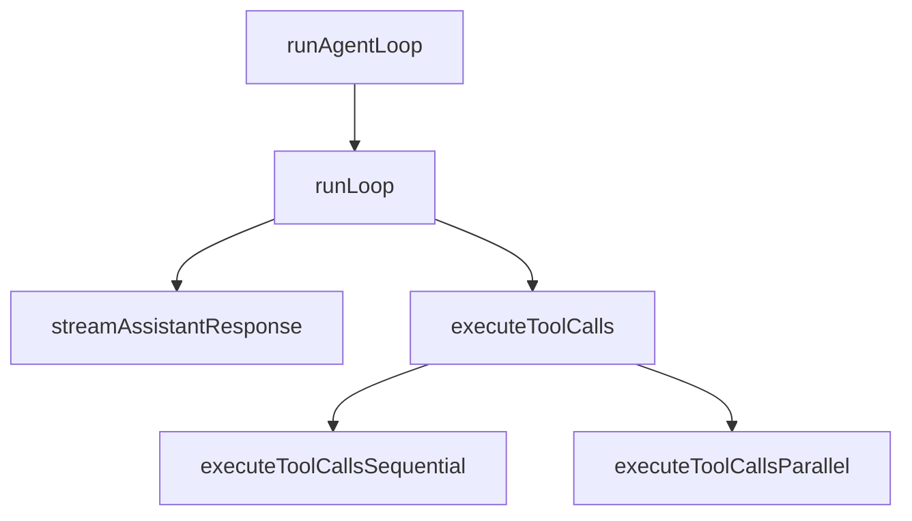
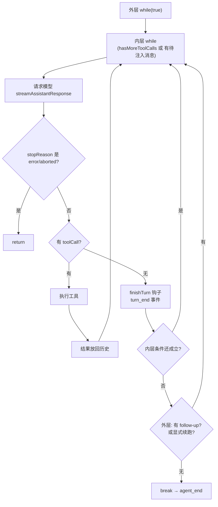

# 第 6 章 代码精读（一）：pi 的推理循环

> **本章目标**
> 1. 逐行读懂 pi 的推理循环实现（`packages/agent/src/agent-loop.ts`）；
> 2. 看懂"双层循环"：外层回合、内层步骤；
> 3. 看懂模型调用的"流式事件处理"；
> 4. 学会从"事件流"的角度理解 Agent 的对外输出。

这是全书第一次"逐行读代码"。请打开 pi 仓库的
`packages/agent/src/agent-loop.ts`（约 940 行），跟着本章一节节读。
建议：**先读本节，再对着文件读一遍**。

## 6.1 文件总览：先看地图，再走迷宫

`agent-loop.ts` 是 pi Agent 运行时的"引擎"。它由以下主要部分组成：

| 行号区间 | 内容 | 作用 |
|---------|------|------|
| 38–63 | `agentLoop` | 低层入口：把整个循环包装成一个"事件流"（EventStream） |
| 71–99 | `agentLoopContinue` | 低层入口：从当前上下文继续循环（用于重试） |
| 102–126 | `runAgentLoop` | 高层入口：带新用户消息启动循环 |
| 128–152 | `runAgentLoopContinue` | 高层入口：不带新消息继续循环 |
| 163–325 | `runLoop` | **核心循环本体**（双层 while） |
| 381–479 | `streamAssistantResponse` | 调用模型、处理流式事件 |
| 508–528 | `executeToolCalls` | 工具分发（串行/并行） |
| 530–692 | `executeToolCallsSequential` / `...Parallel` | 真正执行工具 |
| 707–770 | `prepareToolCall` | 工具调用前的准备与校验 |

**先看两个核心函数的调用关系**：



## 6.2 入口函数：runAgentLoop 与 runAgentLoopContinue

先从 `runAgentLoop`（102 行）看起。它接受：用户消息、上下文、配置、事件回调、
中止信号、模型流函数，返回最终消息数组。

```ts
// packages/agent/src/agent-loop.ts 第 102–126 行
export async function runAgentLoop(
	prompts: AgentMessage[],          // 本次要发的用户消息（可多条）
	context: AgentContext,            // 当前会话上下文（含历史消息）
	config: AgentLoopConfig,          // 各种配置和钩子
	emit: AgentEventSink,             // 事件回调（通知 UI/日志）
	signal: AbortSignal | undefined,  // 中止信号（用户可按 Esc 中断）
	streamFn: StreamFn,               // 模型流函数（可替换/可注入）
): Promise<AgentMessage[]> {
	const initialMessages = declareToolChanges(context, prompts);  // 110
	const newMessages: AgentMessage[] = [...initialMessages];      // 111
	const currentContext: AgentContext = {                         // 112
		...context,                                                // 113
		messages: [...context.messages, ...initialMessages],       // 114
	};

	await emit({ type: "agent_start" });                           // 117
	await emit({ type: "turn_start" });                            // 118
	for (const message of initialMessages) {                       // 119
		await emit({ type: "message_start", message });              // 120
		await emit({ type: "message_end", message });                // 121
	}

	await runLoop(currentContext, newMessages, config, signal, emit,
		streamFn ?? getDefaultStreamFn());                         // 124
	return newMessages;                                            // 125
}
```

逐行解读：

- **第 110 行**：`declareToolChanges`——比较"运行时实际可用的工具"和"历史系统消息里
  声明给模型的工具"，把差异变成一条 `toolsAdded`/`toolsRemoved` 的系统消息。
  这保证"模型看到的工具清单"始终和"运行时能执行的工具"一致，可回放、可审计。
- **第 111–114 行**：创建一个新的 `currentContext`，把用户消息追加到历史后面。
  注意它**复制**了 context 而不是原地修改——避免污染调用方传入的原始对象。
- **第 117–121 行**：发事件。`emit` 是给"外部世界"（UI、日志、测试）的通知机制。
  这里先后发了 `agent_start`（整个运行开始）、`turn_start`（第一个回合开始），
  然后对每条用户消息发 `message_start` / `message_end`（消息进出的标记）。
  **事件流是 pi 的设计核心**：UI 完全靠订阅这些事件来渲染界面，
  外部代码也靠它做测试断言。我们后面还会反复看到 `emit`。
- **第 124 行**：把控制权交给真正的循环本体 `runLoop`。
- **第 125 行**：循环结束后，把收集到的 `newMessages` 返回给调用方。

> **为什么要区分"事件回调"和"返回值"？** 返回值给代码用（拿到最终消息做后续处理），
> 事件给 UI 用（边跑边刷新界面）。两者解耦，是 Agent 框架的常见设计。

`runAgentLoopContinue`（128 行）几乎一样，但**不追加新用户消息**，从现有上下文继续。
它有两个前置校验，值得读：

```ts
// 第 135–141 行
if (context.messages.length === 0) {
	throw new Error("Cannot continue: no messages in context");
}
if (context.messages[context.messages.length - 1].role === "assistant") {
	throw new Error("Cannot continue from message role: assistant");
}
```

为什么最后一条消息不能是 `assistant`？因为模型的请求约定是"最后一条消息必须是
用户消息或工具结果"（第 2 章讲过工具结果是 user 角色）。如果以 assistant 结尾，
模型会认为你让它"接着自己说"，很多 API 会拒绝。**这个校验是在"最靠近使用处"把
错误拦下来**——与其让模型 API 返回一个晦涩错误，不如自己先报一个清楚的错误。

## 6.3 核心：runLoop 双层循环（第 163–321 行）

这是全书最重要的一个函数。我们把它拆成**外层循环**和**内层循环**两半读。

### 6.3.1 函数头与初始化（163–183 行）

```ts
// 第 163–183 行
let currentContext = initialContext;                                  // 171
let config = initialConfig;                                           // 172
let lastCompletedTurn: PrepareNextTurnContext | undefined;            // 173
let explicitContinuation = false;                                     // 174
// Check for steering messages at start (user may have typed while waiting)
let pendingMessages: AgentMessage[] =
	(await config.getSteeringMessages?.()) || [];                     // 176

// Outer loop: continues when queued follow-up messages arrive after agent would stop
while (true) {                                                        // 179
	let hasMoreToolCalls = true;                                       // 180

	// Inner loop: process tool calls and steering messages
	while (hasMoreToolCalls || pendingMessages.length > 0) {           // 183
```

- **第 171–174 行**：可变的上下文、配置、"上一回合快照"（局部变量，允许循环中更新）。
- **第 176 行**：`getSteeringMessages` 是配置里的一个**可选钩子**，用来取"转向消息"。
  什么叫转向消息？想象用户在 Agent 思考时又打字了（"等等，改成读 XML 文件"），
  这条消息在**下一轮模型请求之前**被注入，用来"转向"Agent 的方向。
  `?.()` 表示"如果配置了这个钩子才调用"，是可选功能的惯用写法。
- **第 179 行**：**外层 while(true)**，负责"回合"级别的循环。
- **第 183 行**：**内层 while**，负责"步骤"级别的循环。注意它的继续条件：
  `hasMoreToolCalls || pendingMessages.length > 0`——只要**还有工具调用要处理**
  或**还有待注入的消息**，内层就继续转。

> **先记住这个"双层"结构**：内层跑完一个"步骤"后，如果模型还要继续调工具，
> `hasMoreToolCalls` 会变成 true，内层继续；如果内层停了（模型没再调工具），
> 外层检查是否还有后续消息，有就再开一个回合。这就是 5.2 节说的 turn/step 两层。

### 6.3.2 内层循环：一个"步骤"的处理（183–299 行）

#### ① 跨回合准备与待注入消息（184–217 行）

```ts
// 第 184–217 行（节选）
let preparedMessages: AgentMessage[] = [];                            // 184
if (lastCompletedTurn) {                                              // 185
	const nextTurnSnapshot = await config.prepareNextTurn?.(lastCompletedTurn);  // 186
	if (nextTurnSnapshot) {                                            // 187
		currentContext = nextTurnSnapshot.context ?? currentContext;     // 188
		preparedMessages = nextTurnSnapshot.messages ?? [];              // 189
		config = { ...config, model: ..., reasoning: ... };              // 190–200：可换模型/思考级
	}
	// Preparation can be long-running (for example, compaction).
	if (pendingMessages.length === 0) {                                // 204
		pendingMessages = (await config.getSteeringMessages?.()) || [];  // 205：准备期间又转向
	}
	await emit({ type: "turn_start" });                                // 207：非首回合，再发回合开始
}

// Process prepared and queued messages before the next assistant response.
for (const message of declareToolChanges(currentContext, [...preparedMessages, ...pendingMessages])) {
	await emit({ type: "message_start", message });                    // 212
	await emit({ type: "message_end", message });                      // 213
	currentContext.messages.push(message);                             // 214：注入历史
	newMessages.push(message);                                         // 215
}
pendingMessages = [];                                                 // 217：清空
```

- **第 185–200 行**：`prepareNextTurn` 钩子——允许外部**在回合之间调整**上下文、
  换模型、改推理级别（thinking level）。比如做上下文压缩（compaction）就是
  在这里更新 `currentContext`。这是一个"让外部策略干预循环"的扩展点。
- **第 204–206 行**：注释点明——`prepareNextTurn` 可能耗时很长（例如压缩），
  期间用户可能又输入了转向消息，所以**准备完再拉一次**转向消息。
  并且只在之前没有待处理消息时才拉（否则会一次交付两条，破坏"一次一条"模式）。
- **第 207 行**：非首回合时重新发 `turn_start`，保证"回合"事件数和真实回合数一致。
- **第 211–217 行**：把（跨回合准备的 + 排队的）消息**在请求模型之前**塞进历史。
  注意顺序：先发事件（UI 能看到），再 push 进 `currentContext.messages`（模型能看到）。

#### ② 请求前最后一次调整，然后请求模型（219–256 行）

```ts
// 第 219–256 行（节选）
const requestUpdate = await config.prepareRequest?.(                    // 219
	{ context: currentContext, model: config.model,
		thinkingLevel: config.reasoning ?? "off" }, signal,
);
if (requestUpdate) {                                                   // 227
	currentContext = requestUpdate.context ?? currentContext;            // 228
	config = { ...config, model: ..., reasoning: ... };                  // 229–239
}

// Stream assistant response
const message = await streamAssistantResponse(                         // 242
	currentContext, config, signal, emit, streamFunction);
newMessages.push(message);                                             // 243

if (message.stopReason === "error" || message.stopReason === "aborted") {  // 245
	lastCompletedTurn = { message, toolResults: [], context: currentContext, newMessages };  // 246
	await config.finishTurn?.(lastCompletedTurn, signal);                // 252
	await emit({ type: "turn_end", message, toolResults: [] });          // 253
	await emit({ type: "agent_end", messages: newMessages });            // 254
	return;                                                              // 255
}
```

- **第 219–239 行**：`prepareRequest` 钩子——**发请求前的最后一次机会**调整上下文、
  模型或思考级别。pi 把"干预循环"分散到多个粒度不同的钩子里，每个钩子只管一件事。
- **第 242 行**：调模型（`streamAssistantResponse` 我们 6.4 节精读），
  返回一条完整的 `AssistantMessage`。
- **第 243 行**：把它记入 `newMessages`（本次运行的产出）。
- **第 245–255 行**：**错误/中断快速退出**。`stopReason` 是模型输出的一个"结束原因"
  字段。如果是 `error`（模型调用出错）或 `aborted`（被用户/信号中断），
  就**不再继续循环**，发完收尾事件直接 return。
  这里体现了"**异常不进入工具执行逻辑**"的防御设计。

#### ③ 检查工具调用，执行（259–278 行）

```ts
// 第 259–278 行（节选）
const toolCalls = message.content.filter((c) => c.type === "toolCall");  // 259

const toolResults: ToolResultMessage[] = [];                             // 261
hasMoreToolCalls = false;                                                // 262
if (toolCalls.length > 0) {                                              // 263
	// A "length" stop means the output was cut off by the token limit, so
	// every tool call in the message may carry truncated arguments.
	const executedToolBatch =
		message.stopReason === "length"                                    // 268
			? await failToolCallsFromTruncatedMessage(toolCalls, emit)      // 269
			: await executeToolCalls(currentContext, message, config, signal, emit);  // 270
	toolResults.push(...executedToolBatch.messages);                      // 271
	hasMoreToolCalls = !executedToolBatch.terminate;                      // 272

	for (const result of toolResults) {                                   // 274
		currentContext.messages.push(result);                              // 275：工具结果进历史
		newMessages.push(result);                                          // 276
	}
}
```

- **第 259 行**：从 assistant 消息的内容块里筛出所有 `toolCall` 类型的块。
  （第 2 章讲过 `content` 是内容块数组。）
- **第 262 行**：先假设"没有更多工具调用"（`hasMoreToolCalls = false`）。
  如果真有工具调用，执行完再改回 true。这种"先默认结束，再推翻"的写法，
  让"没工具调用"时循环自然终止。
- **第 263–270 行**：有工具调用时执行。这里有一个**非常值得学习的细节**：
  当 `stopReason === "length"`（输出被 token 上限截断）时，**不执行任何工具**，
  而是把这次截断消息里的所有工具调用标记为失败（`failToolCallsFromTruncatedMessage`）。
  为什么？因为流式输出被截断时，工具参数可能是**残缺的 JSON**（第 3 章的
  `parseArguments` 会宽容解析，但残缺参数执行起来很危险，比如 `rm` 删错文件）。
  所以宁可让模型"重试"，也不执行不完整的调用。**这是"安全优先"的经典决策。**
- **第 272 行**：`terminate` 是工具批量执行返回的一个标志——如果某个工具调用
  声明"到此为止"（例如用户同意某个流程结束），则不再循环。
  注意这里逻辑：`hasMoreToolCalls = !terminate`，即"除非明确终止，否则继续"。
- **第 274–277 行**：把每个工具结果**放回历史**（`currentContext.messages`）——
  这样下一轮模型请求就能看到工具结果，进而决定下一步。**这就是"观察"环节。**

#### ④ 回合结束的钩子与下一轮（280–299 行）

```ts
// 第 280–299 行（节选）
lastCompletedTurn = { message, toolResults, context: currentContext, newMessages };  // 280
const decision = await config.finishTurn?.(lastCompletedTurn, signal);  // 286：回合后钩子
await emit({ type: "turn_end", message, toolResults });                // 287

if (decision?.action === "end") {                                      // 289
	await emit({ type: "agent_end", messages: newMessages });            // 290
	return;                                                              // 291
}

explicitContinuation = decision?.action === "continue";                // 294
pendingMessages = (await config.getSteeringMessages?.()) || [];        // 295：转向消息
if (hasMoreToolCalls || pendingMessages.length > 0) {                  // 296
	explicitContinuation = false;                                        // 297
}
```

- **第 280–286 行**：`finishTurn` 钩子——每回合结束后都回调一次，让外部
  （比如审批、日志、计费）拿到"本回合的消息 + 工具结果 + 上下文"。
- **第 289–291 行**：`finishTurn` 返回的 `decision.action === "end"` 时，
  整个 Agent 直接结束。这是一个强大的扩展点：比如 CLI 可以在这里实现
  "用户按下某个键就停止"。
- **第 294–297 行**：`decision.action === "continue"` 是一种**显式续跑**信号——
  外部说"继续，不用新消息"。但如果同时有工具调用或转向消息要处理，
  就退化为自然继续，`explicitContinuation` 被重置。

### 6.3.3 外层循环：回合之间的衔接（302–320 行）

```ts
// 第 302–320 行（节选）
const followUpMessages = (await config.getFollowUpMessages?.()) || [];  // 302
if (followUpMessages.length > 0) {                                      // 303
	explicitContinuation = false;                                         // 305
	pendingMessages = followUpMessages;                                   // 306：转成待注入消息
	continue;                                                             // 307：回到外层顶部，开新回合
}

if (explicitContinuation) {                                           // 311
	explicitContinuation = false;                                         // 312
	continue;                                                             // 313：无新消息也要续跑
}

break;                                                                  // 317
```

- **内层循环退出后**（模型没再调工具、没有待注入消息），Agent 本来可以停了。
  但外层还有最后两个机会：
  1. **"后续消息"（follow-up messages）**：通常是别的线程/异步任务塞进来的消息
     （比如后台定时任务的汇报）。如果有，就把它们转成待注入消息，`continue`
     回到外层顶部，**开启一个新的回合**。
  2. **显式续跑**：如果之前 `finishTurn` 决策是 `continue`，即使没有新消息
     也再跑一个"上下文回合"（模型看到当前状态后自行决定下一步）。
- **第 317 行**：两个机会都没有，`break` 退出外层循环。
- **第 320 行**：发最后的 `agent_end` 事件。

**这就是完整的外层逻辑**：外层负责"还有没有新消息要处理 / 要不要续跑"，
内层负责"这一个回合还有没有工具要跑"。两层 `while` 一外一内，构成了 pi 的
整个推理循环。



## 6.4 模型调用：streamAssistantResponse（第 381–469 行）

这个函数负责"把历史变成模型请求，再把流式输出变成一条完整消息"。它是
**第 4 章"统一抽象"与第 5 章"循环骨架"的交汇点**。

### 6.4.1 请求前：转换消息、组装上下文（388–409 行）

```ts
// 第 388–409 行（节选）
let messages = context.messages;                                       // 389
if (config.transformContext) {                                         // 390
	messages = await config.transformContext(messages, signal);           // 391：可选：改写上下文
}

const llmMessages = await config.convertToLlm(messages);                // 395：Agent 消息 → LLM 消息

const llmContext = normalizeContext({ messages: llmMessages });         // 397

const resolvedApiKey =
	(config.getApiKey ? await config.getApiKey(config.model.provider) : undefined)
	|| config.apiKey;                                                   // 400–401

const response = await streamFunction(config.model, llmContext, {      // 403
	...config, apiKey: resolvedApiKey, signal,                           // 404–406
});
const result = async () => Object.assign(await response.result(),
	{ thinkingLevel: config.reasoning ?? "off" });                      // 409：记思考级
```

- **第 389–391 行**：`transformContext` 可选钩子，允许在发请求前**改写整个消息数组**
  （例如注入动态系统信息、临时替换某段内容）。这是 pi 给"上下文预处理"留的口子。
- **第 395 行**：`convertToLlm` 把 Agent 内部的消息（可能含 `custom` 等自定义角色）
  转换成**LLM 认识的 Message**。这一步是"适配器"在 Agent 层的映射。
- **第 400–401 行**：解析 API key——pi 允许 `getApiKey` 钩子动态取 key
  （处理会过期的 token），没有就用配置里的 `apiKey`。
- **第 403–407 行**：真正调用 `streamFunction`，拿到一个**事件流** `response`。
  注意 `streamFunction` 是注入进来的（本章开头的 `StreamFn` 类型），
  这**极大提高了可测试性**——测试时可以注入一个"假模型"（faux provider），
  返回预先写好的事件流，从而在**无真实 API、无 key** 的情况下测试整个循环。

### 6.4.2 流式事件处理（411–468 行）

```ts
// 第 411–468 行（节选）
let partialMessage: AssistantMessage | null = null;   // 411：正在累积的"半成品"消息
let addedPartial = false;                            // 412：是否已把半成品放进历史

for await (const event of response) {                // 414：逐个事件消费流
	switch (event.type) {
		case "start":                                   // 416：流开始
			partialMessage = event.partial;               // 417
			context.messages.push(partialMessage);        // 418：先把"空"消息放进历史
			addedPartial = true;                          // 419
			await emit({ type: "message_start", message: { ...partialMessage } });  // 420
			break;

		case "text_start":                             // 423
		case "text_delta":                             // 424：文本增量
		// ... thinking_* / toolcall_* 增量同样处理
			if (partialMessage) {                        // 432
				partialMessage = event.partial;            // 433：更新半成品
				context.messages[context.messages.length - 1] = partialMessage;  // 434：原地替换
				await emit({ type: "message_update", assistantMessageEvent: event,
					message: { ...partialMessage } });     // 435–439
			}
			break;

		case "done":                                    // 443
		case "error": {                                 // 444
			const finalMessage = await result();          // 445：拿最终消息
			if (addedPartial) {                           // 446
				context.messages[context.messages.length - 1] = finalMessage;  // 447：替换
			} else {                                      // 448
				context.messages.push(finalMessage);       // 449：追加
			}
			if (!addedPartial) {                          // 451
				await emit({ type: "message_start", message: { ...finalMessage } });  // 452
			}
			await emit({ type: "message_end", message: finalMessage });  // 454
			return finalMessage;                          // 455
		}
	}
}
```

逐段理解这个事件处理：

- **第 411–412 行**：`partialMessage` 是"正在生成的半成品 assistant 消息"；
  `addedPartial` 记录"是否已经把半成品放进历史"。
- **第 416–421 行**：`start` 事件——流开始，先往历史里 push 一个**空消息**，
  并在 UI 上发 `message_start`。**先把空壳放进历史，之后原地更新它**——
  这是一个精妙的技巧：历史里始终有"当前这条 assistant 消息"的位置，
  后续增量只需 `messages[len-1] = partialMessage` 原地替换（434 行），
  避免反复 push/pop。
- **第 423–441 行**：各种增量事件（文本、思考、工具调用）——每个事件都携带一个
  **最新的 `partial` 快照**，代码直接拿它更新半成品和历史最后一条，然后发
  `message_update` 给 UI。**UI 因此能逐字刷新**。
- **第 443–455 行**：`done` / `error` 事件——流结束。取最终消息（带上思考级别），
  放进历史，发 `message_end`，**返回这条完整的 assistant 消息**给 runLoop。

> **为什么 `partial` 要放在事件里而不是增量里？** 因为事件可能乱序到达
> （不同 provider 实现不同），携带完整快照比"把 delta 拼起来"更稳。
> 这是一种"以不变应万变"的兼容策略。

## 6.5 工具执行：串行与并行（第 508–685 行）

`executeToolCalls` 是 runLoop 调用的下一个关键函数。第 3 章讲过它的大致逻辑，
这里看它如何组织代码（`packages/agent/src/agent-loop.ts` 第 508 行起）：

```ts
// 第 508–528 行（节选）
async function executeToolCalls(
	currentContext: AgentContext,
	assistantMessage: AssistantMessage,
	config: AgentLoopConfig,
	signal: AbortSignal | undefined,
	emit: AgentEventSink,
): Promise<ExecutedToolCallBatch> {
	const toolCalls = assistantMessage.content.filter((c) => c.type === "toolCall");
	const hasSequentialToolCall = toolCalls.some(
		(tc) => currentContext.tools?.find((t) => t.name === tc.name)?.executionMode === "sequential",
	);
	if (config.toolExecution === "sequential" || hasSequentialToolCall) {
		return executeToolCallsSequential(...);   // 串行
	}
	return executeToolCallsParallel(...);          // 并行
}
```

关键点：**只要有一个工具声明自己是串行（`executionMode === "sequential"`），
整批就退化为串行**。为什么？因为"排他"是全局约束——如果一个工具必须在无并发的
环境下运行（比如修改同一份文件），那么即使其他工具能并行，也不能和它同时跑。

`executeToolCallsSequential` 的核心是一个 `for` 循环（530–584 行）：每个调用依次经过
`prepareToolCall`（准备/校验）→ 执行 → `finalizeExecutedToolCall`（收尾）
→ 发 `tool_execution_end` 事件 → 生成工具结果消息。中途检查 `signal?.aborted`，
一旦被中断就停止执行剩下的调用。

`executeToolCallsParallel`（586–685 行）则把"准备"和"执行"分离：先把所有调用**准备好**
（`prepareToolCall`，这是同步的、安全的），把执行函数收集成数组，
最后用 `Promise.all` 并发执行，但**结果的顺序仍按模型声明顺序排列**（第 3 章
强调过的"并行执行、按序返回"）。并且它把"立即完成"（immediate，比如被 before 钩子
拦截）与"真正执行"分两类处理，保证事件和结果顺序正确。

## 6.6 设计亮点小结

读完全文件，总结 pi 这版循环最值得学习的 5 个设计：

1. **双层循环**（外层回合 / 内层步骤）清晰分离了"消息驱动"和"工具驱动"；
2. **事件流驱动 UI**：所有状态变化都通过 `emit` 事件对外广播，UI 与循环解耦，
   测试也可通过订阅事件断言；
3. **流式消费 + 半成品原地更新**：历史里始终保留当前 assistant 消息的位置，
   增量事件只做"替换最后一条"；
4. **安全优先的截断处理**：`length` 截断时拒绝执行任何工具；
5. **大量可选钩子**（`getSteeringMessages`、`prepareNextTurn`、`prepareRequest`、
   `finishTurn`、`getFollowUpMessages` 等）把"外部策略"从循环里抽离——
   循环本身只做通用逻辑。

**pi 的局限**（对比后面两章的动机）：

- 会话是**纯内存**的，进程退出即丢；dsh 用持久化会话日志解决（第 7、11 章）；
- 错误处理相对简单（没有结构化的重试策略）；codex 的重试/压缩/沙箱更完整（第 8、13 章）；
- 没有"请求可重建"的保证；dsh 的"模型可见 ⟺ 可记录"是它的核心卖点（第 11 章）。

## 6.7 本章小结

- pi 的推理循环 = 外层 `while(true)`（回合）+ 内层 `while`（步骤）；
- 内层：跨回合准备 → 注入消息 → 请求模型 → 看 stopReason → 筛工具调用 →
  执行 → 结果放回历史 → `finishTurn` 决策 → 循环；
- `streamAssistantResponse` 把"模型流"变成"事件流 + 完整消息"；
- 工具执行支持串行/并行，且"有串行则整体串行"；
- 事件流是 pi 与 UI/测试对话的窗口。

## 动手练习

1. **改代码验证**：把 `runLoop` 第 263 行的 `if (toolCalls.length > 0)` 临时改成
   `if (false)`，跑一个需要工具的任务，观察 Agent 会不会"直接结束而不调工具"。
   （用 pi 的 `./pi-test.sh` 或跑它的测试，记得改回来。）
2. **读事件订阅方**：在 `packages/coding-agent/` 里找到订阅 `AgentEvent` 的地方，
   看 UI 如何处理 `message_update` / `tool_execution_start` 等事件。
3. **写一个假模型测试**：模仿 `packages/ai/src/providers/faux.ts`，写一个返回
   "先调一个工具、再给最终回答"的假流，用 `runAgentLoop` 跑一遍，观察
   `newMessages` 里出现了几条消息，分别是哪些角色。
4. **思考题**：为什么 `length` 截断时要"拒绝执行工具"而不是"尽力执行"？
   结合第 3 章的 `parseArguments` 思考"残缺参数"可能带来的风险。

---

**下一章**：[第 7 章 代码精读（二）：dsh 的回合与步骤](./ch07-code-dsh.md)
pi 让我们看到了"教科书"版本。现在进入 dsh——看一个"插件化、持久化、严谨"的
Agent 循环如何在前面的骨架上做工程化升级。
